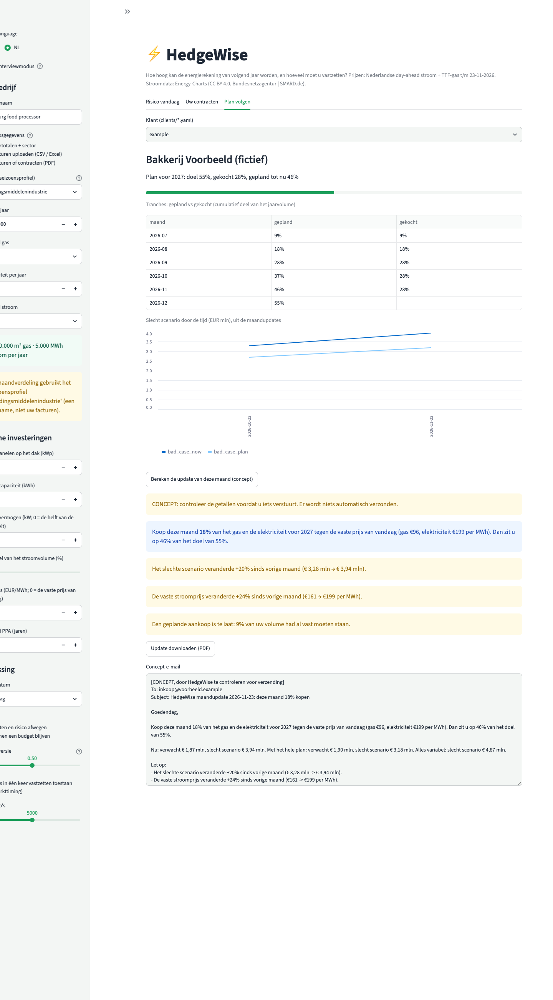

# HedgeWise monthly monitoring

Once a month HedgeWise recomputes every client's risk with the latest prices and writes a **draft** update: what
changed, what the plan says to buy this month, and the progress of the plan. **Nothing is sent automatically.** A
person reads every draft, checks the numbers and sends it.

## 1. One file per client

Copy `clients/example.yaml` to `clients/private/<client>.yaml` (`clients/private/` is never committed: client data is
confidential) and fill in:

* `name`, `language` (`nl` or `en`), `email` (only used in the draft)
* `consumption`: a bill file (`file:`) or yearly totals (`yearly:`), plus the `sector` profile
* `risk_aversion` (default 0.5) or `budget`
* `plan`: `delivery_year`, the agreed `target_share` (from the report), the `tranche_months` (equal monthly
  purchases), and every tranche actually bought: `date`, `share` of the yearly volume, `gas_eur_mwh`,
  `power_eur_mwh`. **Add a tranche to the file as soon as the client has bought it.**

The plan rule is fixed in advance: by the end of each tranche month, `target × (months so far / number of months)`
should be fixed. The model's current advice is shown for information only; it never changes the plan by itself.

## 2. Run it by hand (first working day of the month)

```bash
cd ~/hedgewise
source .venv/bin/activate
python monitor.py                 # refreshes prices first (skipped if offline), then every client
python monitor.py --no-download   # use the prices already in data/
```

Per client it writes, in `output/monitor/`:
* `<client>_<date>_update.pdf`: one page in the client's language (draft marked in red): what to do this month,
  the bad case and expected bill now and with the full plan, what changed since last month, a plan progress bar
  and the bad case over time;
* `<client>_<date>_email.txt`: an email draft with the same message.

Plus `output/monitor/overview_<date>.csv` (one row per client: bought / planned / target, what to buy, the bad case
now and last month, and the flags) and the history `output/history/<client>.csv` (one row per monthly run; a rerun on
the same day replaces that day's row). Both folders are git-ignored.

**Flags** (in the PDF, the email and the overview): the bad case moved more than 15% since last month, a fixed price
moved more than 20%, or a planned tranche is overdue. Thresholds are in `config.yaml` (`monitor`).

**Checklist before sending:** the tranches in the client file are up to date; the prices look plausible (compare with
a supplier quote if you have one); the advice ("buy X%") matches what was agreed; every flag is explained in the
email; then send the PDF from your own mailbox.

In the app, the tab **Plan tracker / Plan volgen** shows the same for one client (planned vs bought, the bad case
over time) and has a button that computes this month's draft and offers the PDF and the email text.



## 3. Schedule it

The schedule only *prepares* the drafts. Someone still has to read and send them.

### On a Mac (launchd), the 1st of every month at 07:00

Save as `~/Library/LaunchAgents/nl.hedgewise.monitor.plist` (replace `YOU` with your user name):

```xml
<?xml version="1.0" encoding="UTF-8"?>
<!DOCTYPE plist PUBLIC "-//Apple//DTD PLIST 1.0//EN" "http://www.apple.com/DTDs/PropertyList-1.0.dtd">
<plist version="1.0">
<dict>
  <key>Label</key><string>nl.hedgewise.monitor</string>
  <key>WorkingDirectory</key><string>/Users/YOU/hedgewise</string>
  <key>ProgramArguments</key>
  <array>
    <string>/Users/YOU/hedgewise/.venv/bin/python</string>
    <string>monitor.py</string>
  </array>
  <key>StartCalendarInterval</key>
  <dict><key>Day</key><integer>1</integer><key>Hour</key><integer>7</integer><key>Minute</key><integer>0</integer></dict>
  <key>StandardOutPath</key><string>/Users/YOU/hedgewise/output/monitor/launchd.log</string>
  <key>StandardErrorPath</key><string>/Users/YOU/hedgewise/output/monitor/launchd.log</string>
</dict>
</plist>
```

Then `launchctl load ~/Library/LaunchAgents/nl.hedgewise.monitor.plist`. (If the Mac is asleep at 07:00, launchd runs
it when it wakes up.) To stop: `launchctl unload` the same file.

### Free GitHub Actions schedule (only with the example client, or with encrypted client data)

Client files are confidential and must not be in a public repository. In a **private** repository, a scheduled
workflow can prepare the drafts and keep them as a downloadable artifact for 30 days:

```yaml
# .github/workflows/monitor.yml
name: Monthly update (drafts)
on:
  schedule: [{cron: "0 6 1 * *"}]   # 06:00 UTC on the 1st of every month
  workflow_dispatch: {}
jobs:
  monitor:
    runs-on: ubuntu-latest
    steps:
      - uses: actions/checkout@v4
      - uses: actions/setup-python@v5
        with: {python-version: "3.12"}
      - run: pip install -r requirements.txt
      - run: python monitor.py           # refreshes prices, then every client in clients/
      - uses: actions/upload-artifact@v4
        with: {name: monthly-update-drafts, path: output/monitor/, retention-days: 30}
```

Note that the history in `output/history/` doesn't persist between GitHub runs unless you commit it or store it as an
artifact; for real clients, the Mac schedule is simpler.

## 4. Tests

`tests/test_monitor.py` runs the example client on the fixed price snapshot in `data/` for two months (23 Oct and 23
Nov 2026) and checks the plan arithmetic by hand (buy 9% in October; 18% in November with October's tranche flagged
as overdue), the position cost per scenario, the flags, the history file, the PDF and the email in both languages.
