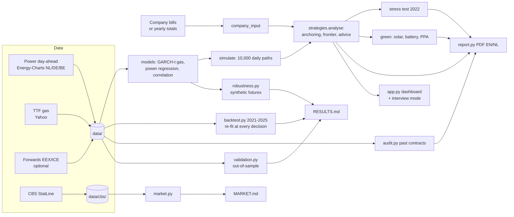

# HedgeWise model (v0.7)

Energy price-risk model for mid-sized Dutch companies: **consumption in → worst-case bill and hedge recommendation out.**

> **Pitch numbers come from git tag `pitch-freeze-v1`** (23 Nov 2026): see `PITCH_NUMBERS.md` for every number allowed
> on a slide, its source and its caveat. The recommendation is the HedgeWise ladder, pre-registered that day
> (`PREREGISTRATION.md`). To reproduce: `git checkout pitch-freeze-v1`.

## How it fits together



## Quick start

```bash
cd ~/hedgewise
source .venv/bin/activate          # or: python3 -m venv .venv && pip install -r requirements.txt
python download_data.py            # refresh prices (about 5 min, rate-limited API)
python hedgewise_model.py          # today's view for next calendar year
python backtest.py                 # strict 2021-2025 backtest + pitch chart
python report.py --lang nl         # one-page PDF risk report for a CFO (EN or NL)
python audit.py data/audit_example.csv   # procurement audit: your past contracts vs the strategies (~30 s)
python report.py --audit data/audit_example.csv   # ... adds the audit as page 2 of the PDF
python report.py --green-solar-kwp 1000 --green-battery-kwh 1000 --green-ppa-share 0.4   # + one green-investment line
python validation.py               # out-of-sample model validation (~1-2 min) -> METHODOLOGY.md
python extract.py bill.pdf [--ai]  # read PDF invoices/contracts (--ai = consent to send them to the AI service)
python monitor.py --no-download   # monthly update drafts for every client in clients/ (see MONITORING.md)
python forwards_import.py export.xlsx   # real forward prices (Refinitiv/Bloomberg/EEX/ICE export) -> data/forwards.csv
python run_with_forwards.py        # rerun everything with them; "proxy vs real forwards" section in RESULTS.md
python pilot.py "data/private/<company>" --alias "Bedrijf A"   # one interviewed company -> reports + sanity check
git config core.hooksPath hooks    # once per clone: the pre-commit hook that blocks client data and licensed prices
python market.py                  # market size from CBS open data -> MARKET.md numbers (--offline: data/cbs/ snapshot)
python robustness.py --histories 200   # synthetic 8-year futures (~25 min on 4 cores; resumable, see below)
python download_data.py --extended && python backtest.py --market DE-LU --years 2020 2021 2022 2023 2024 2025
streamlit run app.py               # live demo dashboard in the browser (?lang=nl&mode=interview for interviews)
python -m pytest -q --cov          # tests + coverage (pip install -r requirements-dev.txt)
ruff check . && ruff format --check .   # lint
```

To put the dashboard online (private GitHub repo + Streamlit Community Cloud), follow `DEPLOY.md`.

Every chart and table is written to `output/`. See `RESULTS.md` for the numbers.

## Files

The code lives in the `hedgewise/` package. The scripts in the repository root are thin wrappers, so every command
below works as before. When imported (`import backtest`, `import hedgewise_model`), a wrapper *is* the package module.

| Where | What it does |
|---|---|
| `config.yaml` | **Every modelling assumption** (premium, look-back, floors, caps, scenario count, seed, solar yield, sector profiles, default company, backtest settings), with a comment on each. Read once and validated by `hedgewise/config.py`; override with `HEDGEWISE_CONFIG=other.yaml` |
| `hedgewise/__init__.py` | The public, audit-ready API (explicit `__all__`); its docstring shows the pipeline in 7 lines |
| `hedgewise/data.py` | Loads prices (`load_prices`, investing.com formats, optional CO₂), demo data |
| `hedgewise/company.py` | `Company`: monthly gas/power profile, rooftop solar |
| `hedgewise/models.py` | GARCH(1,1)-t, power regression, correlation, `fit()`, `describe()` |
| `hedgewise/simulate.py` | Monte Carlo price paths |
| `hedgewise/strategies.py` | `analyse()` (strategies, risk, optimiser, budget mode), policy, stress test, advice text |
| `hedgewise/charts.py` | All model charts |
| `hedgewise/report.py` | One-page A4 PDF (English or Dutch), DejaVu Sans embedded |
| `hedgewise/backtest.py` | Strict backtest (each decision re-fits on data up to that date only) |
| `hedgewise/company_input.py` | Real bills: any CSV/Excel export, Dutch formats, yearly totals + sector |
| `hedgewise/forwards.py` | Real forward prices from `data/forwards.csv` (if present) |
| `hedgewise/validation.py` | Out-of-sample validation: monthly forecasts from June 2020, coverage / Kupiec / Christoffersen / CRPS / pinball for 5 variants, pre-registered selection rule |
| `hedgewise/green.py` | Green investments as a hedge: hourly prices inside each simulated month (real day profiles × simulated monthly level), rooftop solar (self-consumption vs export at 80% of day-ahead), a battery (daily cycle + peak shaving), a PPA; their effect on the expected and bad-case bill, payback in normal vs crisis scenarios, extra points on the trade-off chart. Assumptions in `config.yaml` (`green`) |
| `hedgewise/audit.py` | Procurement audit ("what would HedgeWise have saved you?"): past contracts per delivery year (share, price in EUR/MWh, ct/kWh, EUR/kWh, EUR/GJ or EUR/m³, optional date fixed; partial years allowed) vs all variable, fix 100% in October, 60% tranches, the 2-year ladder and the HedgeWise ladder, on real prices with the backtest's rules. Template: `data/audit_example.csv` (made-up company). App tab "Your past contracts" (EN/NL), optional PDF page 2 |
| `hedgewise/market.py`, `MARKET.md` | Market size from CBS StatLine (tables 81589NED, 81578NED, 83583NED, 83989NED; snapshot in `data/cbs/` for offline runs): target companies NL and Limburg, their energy use and spend, revenue at 1/5/10% adoption |
| `hedgewise/app_text.py`, `hedgewise/texts.py` | Every dashboard text in English and Dutch; the PDF's sentences and number formats (shared by app and PDF) |
| `TEAM_GUIDE.md`, `tools/screenshots.py` | Guide for the (non-coding) team: interviews, what the numbers mean, allowed claims, 15 hard questions; screenshots made with headless Chrome |
| `hedgewise/extract.py` | Reads PDF invoices/statements/contracts (NL/EN) into monthly volumes, prices and dates with page + quote + confidence; engine (a) pdfplumber + rules (local), engine (b) Anthropic API with a strict JSON schema only with `ANTHROPIC_API_KEY` and the user's consent; plausibility flags; a person confirms in the app before anything is used. AI only reads, never advises |
| `hedgewise/monitor.py`, `clients/`, `MONITORING.md` | Monthly update per client (DRAFTS, nothing is sent): refresh prices, refit, bad case now and with the full plan, what to buy this month, flags (bad case ±15%, prices ±20%, overdue tranche), one-page PDF (EN/NL), email draft, overview; app tab "Plan tracker" |
| `hedgewise/forwards_import.py`, `hedgewise/forwards_run.py`, `FORWARD_SOURCES.md` | Importers for real forward-price exports (Refinitiv, Bloomberg, EEX DataSource, ICE Endex; calendar-year baseload TTF / Dutch power only, report with gaps) and the one-command rerun with them (`run_with_forwards.py`: separate output folder, side-by-side section in RESULTS.md, flags pitch numbers that move >5%; refuses FAKE data in RESULTS.md). Which free sources were checked and why none works |
| `hedgewise/pilot.py`, `CONSENT.md`, `hooks/pre-commit` | The pilot for one interviewed company (documents in `data/private/<company>/` → confirmation → EN/NL report + sanity-check sheet, alias option); the NL/EN consent text; the hook that blocks `data/private/`, `clients/private/`, forward prices and bundles even when force-added. Fixture invoices in public bill layouts: `tests/fixtures/invoices/` (accuracy 58/58, `ACCURACY.md`) |
| `hedgewise/robustness.py` | Strategies on synthetic 8-year futures (model, block bootstrap, 3 named stress paths). Runs in chunks of 20 histories, each saved to `output/robustness_chunks/` as soon as it finishes (git-ignored); rerunning the same command resumes, and at most 4 worker processes are used |
| `hedgewise/provenance.py` | Writes config hash, data hashes and data date range into every output |
| `hedgewise/settings.py`, `config.py`, `naming.py`, `cli.py`, `_types.py` | Settings from config, config loader, output names, model CLI, type aliases |
| `hedgewise_model.py`, `backtest.py`, `report.py`, `company_input.py`, `forwards.py` | Thin wrappers (commands unchanged) |
| `app.py` | Streamlit dashboard for the live demo |
| `download_data.py` | Refresh power (Energy-Charts / ENTSO-E) and gas (Yahoo `TTF=F`) prices |
| `tests/` | 174 tests incl. `test_golden.py` (backtest totals must match `golden_backtest.json` to within €1) and a dashboard smoke test |
| `requirements.txt` / `requirements-dev.txt` / `requirements.lock` | Minimum versions / + test tools / exact versions that produced the committed results |
| `.github/workflows/ci.yml` | Ruff (lint + format) and pytest on Python 3.11 and 3.12, on every push |
| `data/company_example.csv` | Template for pilot data (month, gas_m3, power_kwh) |
| `data/forwards_example.csv` | **Fake** forward prices, only for the tests. Never copy it to `data/forwards.csv` |
| `METHODOLOGY.md` | How the model works, how it is validated, the results, and where every model fails |
| `DEPLOY.md`, `.streamlit/config.toml` | Deployment steps, dashboard theme |

## Reproducibility and quality

* **Provenance:** every output records the config hash, a hash of each price file, the data date range and the
  version. CSVs get `#` lines on top (read them with `pd.read_csv(path, comment="#")`), JSONs a `_provenance` key,
  PNGs a `Description` text chunk, and PDFs a footer line plus document metadata. There are no timestamps, so the
  same code, config and data give identical files.
* **Exact environment:** `pip install -r requirements.lock` (Python 3.14.3, macOS arm64). CI tests the looser
  `requirements.txt` on Python 3.11 and 3.12.
* **Checks:** `ruff check . && ruff format --check .` and `python -m pytest --cov`. Coverage of the non-plotting
  code is 97%, with a floor of 80% (plotting is checked by looking at the charts).
* **Golden numbers:** if an intended change moves a backtest total, regenerate `tests/golden_backtest.json`
  deliberately and say why in the commit message.

## Useful commands

```bash
python hedgewise_model.py --as-of 2021-06-30                 # what the model said before the crisis
python hedgewise_model.py --as-of 2022-06-30                 # ... and in the middle of it
python hedgewise_model.py --risk-aversion 0.8                # 0.3 / 0.5 / 0.8 now give different answers
python hedgewise_model.py --budget auto                      # smallest hedge that keeps VaR95 within budget
python hedgewise_model.py --budget 1500000
python hedgewise_model.py --company data/pilot_x.csv         # a real company's bills (CSV or Excel, any export)
python hedgewise_model.py --company bills.xlsx --sector metal  # sector profile fills 1-3 missing months
python hedgewise_model.py --yearly-gas 300000 --yearly-power 1500 --sector offices --name "Kantoor Venlo"
python company_input.py bills.xlsx                           # check how a file is read (columns, units, warnings)
python report.py --company data/company_example.csv --lang nl   # -> output/report_<name>_<date>.pdf
python forwards.py data/forwards.csv                         # check a forward-price export
python hedgewise_model.py --solar-kwp 1000                   # green investment: rooftop solar
python hedgewise_model.py --allow-timing                     # let the optimiser fix everything at once
python hedgewise_model.py --demo                             # synthetic data, no files needed
python backtest.py --risk-aversion 0.3 0.5 0.8 --typical-month 11 --years 2021 2022 2023
python backtest.py --company data/pilot_x.csv
```

## How the model works

1. **Gas (and CO₂ if `data/co2_eua.csv` exists):** a GARCH(1,1) with Student-t errors on daily log returns, fitted by maximum likelihood. Prices are simulated as a martingale, so there is no built-in view on direction.
2. **Power:** `log P = a + b·log gas [+ c·log CO₂] + annual seasonality + weekend effect + AR(1) residual`, with Student-t innovations. Fitted on the last 2 years. Power inherits gas crises and keeps its own spikes.
3. **Correlation:** the shocks are correlated using standardized residuals. Fat tails are joint.
4. **Monte Carlo:** 10,000 daily paths from the as-of date to the end of the delivery year.
5. **Anchoring (new in v0.3):** the simulated paths are scaled so the expected delivery price equals today's fixed price minus the premium (ramping from 1 today to the full scale at delivery). Fixed prices quoted on later tranche dates are martingales around today's fixed price. *The market sets the level, the model sets the risk*, so hedging costs exactly the premium in expectation. Switch off with `fixed_price.anchor_to_forward: false` in `config.yaml`.
6. **Strategies:** all variable; fix 60% now; fix 100% now; fix in monthly tranches (up to 6); and HedgeWise.
7. **HedgeWise optimizer:** grid search over one hedge ratio for gas and power (0–100% in 5% steps; `optimiser.same_ratio: false` in `config.yaml` for separate ratios), executed in tranches. It has two goals:
   * `--risk-aversion γ`: minimize `E[cost] + (γ/2)·Var[cost] / E[all-variable bill]`. Variance is quadratic in the hedge ratio, so the answer is interior (roughly `1 − premium / (γ·CV²)`). The v0.2 objective `(1-λ)·E + λ·ES95` is linear in the ratio (ES is positively homogeneous) and could only answer 0% or 100%; it's still available as `optimiser.objective: mean_es` in `config.yaml`.
   * `--budget`: the smallest hedge that keeps the 95% VaR within budget. `auto` means the last 12 months' bill plus 20%.
8. **Efficient frontier:** expected bill against bad-case bill for every share fixed, with the recommendation marked. This is the main chart for a CFO.
9. **Risk metrics:** expected cost, median, 95% VaR, 95% Expected Shortfall (the average of the worst 5%), and the worst simulated year.
10. **HedgeWise policy (v0.4, `policy_plan`):** the optimizer's share becomes a *target*. Its rise is capped at 20 percentage points between monthly decision dates, and the rest is bought in equal monthly tranches (never front-loaded, never sold back). Why 20: six monthly dates give five steps, and 5 × 20 = 100%. It isn't tuned on the backtest.
11. **Stress test (`stress_test`):** two historical scenarios instead of one: (a) the 2022 monthly prices repeat exactly; (b) a shock as big as 2021→2022 from today (today's fixed price × 2022 avg / 2021 avg, with the 2022 monthly pattern; gas ×2.81, power ×2.35). The implied average prices are printed everywhere.
12. **Real forwards (v0.4, `forwards.py`):** if `data/forwards.csv` exists (columns date, product such as `TTF Cal-27` / `NL Base Cal-27`, and price), the latest quote on or before the decision date replaces the proxy as the fixed price and as the anchor (expected spot = forward / 1.05). Every output says which source was used. `data/forwards.csv` is git-ignored because licensed data must not be pushed.
13. **HedgeWise ladder = the recommendation (pre-registered 23 Nov 2026, `PREREGISTRATION.md`):** 40% in H2 of Y-2, then a top-up to the model's target (γ = 0.5) in H2 of Y-1, capped at the previous season's target + 10 points (`strategies.apply_ladder` / `recommend`; app, PDF, CLI and monitor). `--rule model-only` gives the plain optimiser (not recommended: procyclical). ⚠️ Designed after seeing the 2021–2025 results, so that period is in-sample.
14. **Honest bad case:** everywhere a client sees a bad case, it is the higher of the model's ES95 and the bill in a repeat of the 2021→2022 shock (labelled model / stress), because the model's 12-month ranges held only 72% of outcomes before the 2021–22 crisis. The recommendation doesn't use it (mean-variance objective).

**Consumption input (v0.4, `company_input.py`):** units m³ / kWh / MWh / GJ for gas (1 GJ = 0.2778 MWh) and kWh / MWh for power. It handles Dutch numbers (`1.234,5`) and month names (`januari 2025`, `mrt-25`), and title rows above the table. With several years it averages per calendar month. If 1–3 months are missing it fills them from the sector profile with a warning; with more missing it raises an error. The sector profiles (food processing, metal, greenhouse horticulture, offices) are **assumptions** in `config.yaml` (`sector_profiles`).

**Company profile (assumption, replace with interview or pilot data):** a hypothetical Limburg food processor using 1.2 million m³ of gas a year (≈11.7 GWh, winter-heavy) and 5 GWh of power (flat, small summer bump). Check against CBS StatLine: search "energieverbruik industrie bedrijfstak" for the food industry (SBI 10). Or better, use your first interview.

## Limitations (say these out loud in Q&A, before the jury does)

1. **No real forward prices yet.** The loader is ready (`forwards.py`), but until `data/forwards.csv` exists the "fixed price" is the 30-day average spot price (power seasonally adjusted) + 5%. Real Cal-year forwards differ, especially in 2021–22 when the curve was steeply backwardated. Get EEX/ICE Endex data via Refinitiv or Bloomberg (ask the UM library or the SBE finance department). With real forwards, the model still assumes a 5% risk premium inside the forward.
2. **Commodity cost only.** Network tariffs, energy tax, ODE and supplier margins are left out. They're the same across strategies but make the total bill bigger.
3. **The model underestimated the 2021–22 crisis.** The realised 2021 and 2022 bills were outside the model's 95% range as of June the year before. A GARCH model fitted on calm 2019–2021 data can't foresee a war, and the ES95 of €2.1m still undershot the €2.67m actual. Use this as a selling point for *stress scenarios on top of the model*, not as a reason to trust the model blindly.
4. **No mean reversion in gas, and the optimizer is procyclical.** Prices are a random walk and GARCH volatility peaks after prices spike, so the optimizer hedges most when prices are highest (H2 2022 → expensive 2023). In the backtest, simple disciplined rules (60% in tranches, layered over 2 years) beat the optimizer. See RESULTS.md.
5. **Consumption is assumed known** (no volume risk), and the premium is a flat 5%. With real forwards the premium varies, which will move the recommendation.
6. **Monthly baseload prices.** There's no hourly profile and no shape or imbalance cost. Simulated power can't go negative (floored at €5/MWh).
7. **Data sources.** Gas is the Yahoo TTF front-month, which has roll jumps. Power comes from Energy-Charts (CC BY 4.0, Bundesnetzagentur | SMARD.de): fine for a pitch, but use ENTSO-E for a product. CO₂ isn't loaded yet; download it manually from investing.com.
8. **Solar**: `--solar-kwp` (CLI) is the simple model (900 kWh/kWp/yr, all used on site, valued at the monthly average
   price). The app and `report.py --green-*` use `hedgewise/green.py` (hourly profiles, export at 80%, capex, payback);
   see RESULTS.md "Green investments" for its assumptions and limits.

## Sanity checks done

* Results are stable across random seeds. All-variable ES95 (as of 2021-06-30) was €2.06m, €2.12m and €2.16m for seeds 1, 2 and 3, within ±2.5%.
* The 2022 gas peak in the data was €339/MWh, with a yearly average of €124. Power averaged €243/MWh, which matches public figures.
* The backtest decisions only use `df.loc[:decision_date]` (see `backtest.run_year`).
* v0.3: with anchoring, "Fix 100% now" costs exactly 1.05 × the expected all-variable bill, and tranches cost the same as fixing now in expectation (checked at 3 dates).
* v0.3: risk aversion 0.3 / 0.5 / 0.8 → 40% / 70% / 85% fixed as of 30 Jun 2021 (single ratio, 4,000 scenarios).
* v0.7: a fresh clone (install from `requirements.lock`, ruff, 147 tests, backtest, validation, a small robustness run, the app, PDFs in EN and NL) reproduced the committed backtest and validation outputs byte for byte (23 Nov 2026).
* Still to do: a teammate who didn't build the model reruns `python backtest.py` and gets the same numbers.
