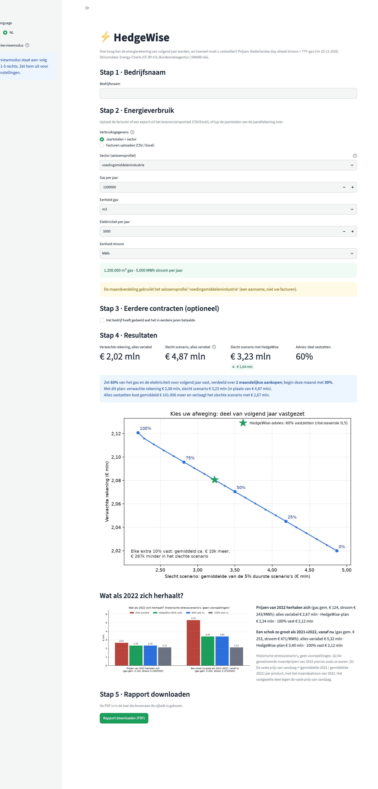
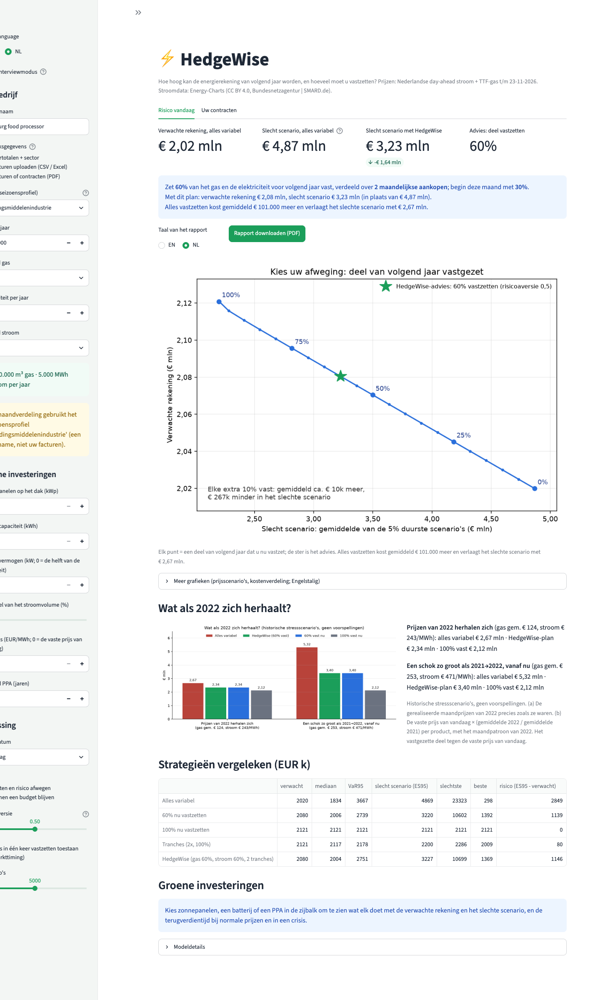
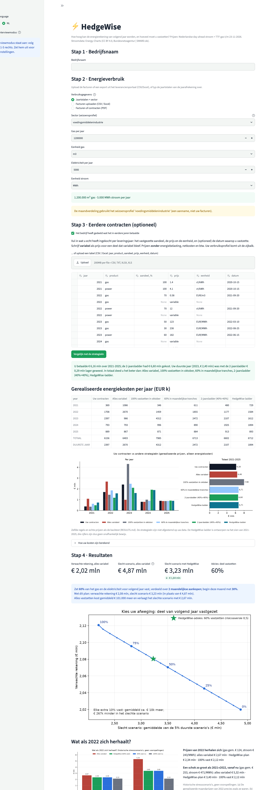

# HedgeWise: team guide (for interviews and the pitch)

Plain English, no coding needed. If something here disagrees with the app, trust the app and tell Bruno.

## 1. Start the app

**Online (easiest).** The app isn't online yet. Once Bruno has followed `DEPLOY.md`, the link will be something like
`https://hedgewise-demo.streamlit.app`. For interviews, add **`?lang=nl&mode=interview`** to the end of the link
(for example `https://hedgewise-demo.streamlit.app/?lang=nl&mode=interview`): it opens in Dutch, in interview mode.

**On a laptop with the code** (Mac):
1. Open the **Terminal** app.
2. Type `cd ~/hedgewise` and press Enter.
3. Type `source .venv/bin/activate` and press Enter.
4. Type `streamlit run app.py` and press Enter. A browser tab opens at `http://localhost:8501`.
   For interview mode in Dutch, open `http://localhost:8501/?lang=nl&mode=interview`.
5. To stop: go back to Terminal and press Ctrl+C.

The first result takes about 5–10 seconds (the price model is being fitted); after that it's quick.

## 2. Make a report for an interviewee (interview mode, about 2 minutes)

At the top of the left-hand bar: **Taal / Language** (NL or EN) and the **Interviewmodus / Interview mode** switch.
With interview mode on, the page shows five steps and hides all model settings.

1. **Company name** (Bedrijfsnaam). It goes on the report.
2. **Energy use** (Energieverbruik). Either
   * **Yearly totals + sector**: type the gas use (m³ is the default; also kWh, MWh, GJ) and the electricity use
     (MWh is the default; also kWh) from the annual statement, and choose the sector closest to theirs. The months are
     filled in with a typical seasonal pattern for that sector (an assumption; the yellow note says so), **or**
   * **Upload bills**: a CSV or Excel file with one row per month (a supplier-portal export works). HedgeWise finds
     the date, gas and power columns and their units itself; check what it found in the boxes that appear. If 1–3
     months are missing, it fills them in and says so; with more missing it asks for more data.
   The green line shows the yearly totals it will use. **Read them out to the interviewee and check them.**
3. **Past contracts (optional)**: see section 3.
4. **Results** (Resultaten) appear by themselves: see section 4.
5. **Download the report** (Rapport downloaden): a one-page PDF in the language chosen at the top (two pages if
   past contracts were entered). Email it to the interviewee afterwards, not during the talk.

The full dashboard (interview mode off) has the same results plus settings: decision date (e.g. "30 Jun 2021,
before the crisis" for the story), risk appetite or budget, green investments, more charts.

## 3. Enter past contracts ("what would HedgeWise have saved you?")

Tick the box in step 3 (or use the tab **Uw contracten / Your past contracts** in the full dashboard). The table is
pre-filled with a made-up example: overwrite it, one row per contract.

| Column | What to enter |
|---|---|
| jaar / year | delivery year, 2021–2025 |
| product / commodity | gas or power |
| aandeel_% / share_% | share of that year's volume at that price, e.g. 70 |
| prijs / price | the fixed price, or **variabel** for a part they left variable |
| eenheid / unit | EUR/MWh, ct/kWh, EUR/kWh, EUR/GJ, or EUR/m3 (gas). Prices **without** energy tax, network costs and VAT |
| datum / fixed_on | optional: the date they signed (then the app also shows the market price that day) |

Click **Vergelijk met de strategieën** (about a minute the first time). You get a sentence like
"U betaalde € 6,16 mln over 2021-2025; de 2-jaarsladder had € 6,60 mln gekost …", a table and a chart.
**If the company did better than our strategies, the app says so. Say it out loud too.** That honesty is the point.

## 4. What each number means

| Number | Meaning |
|---|---|
| **Verwachte rekening / Expected bill** | Average gas + power commodity bill for next calendar year over thousands of simulated price paths, if they buy everything at the variable (day-ahead) price. |
| **Slecht scenario / Bad case** | The average of the worst 5% of those paths ("expected shortfall"). Not the worst case; a plausible bad year. |
| **Slecht scenario met HedgeWise** | The same bad case if they follow our plan (fix the advised share in monthly steps). The green number is how much the plan takes off. |
| **Advies: deel vastzetten / Share to fix** | Share of next year's volume to fix now, spread over the remaining monthly buying dates before January. |
| **The trade-off chart** | Every share from 0% to 100%: right = bigger bad case, up = dearer on average. In the model, fixing more costs a little more on average (the ~5% premium inside fixed prices) and removes some of the bad case. The star is our advice. |
| **Wat als 2022 zich herhaalt?** | Two historical stress tests, not forecasts: the 2022 prices exactly, and a shock as big as 2021→2022 starting from today's prices. |
| **Past contracts table** | What they actually paid per year (commodity only) next to what 5 simple strategies would have cost with the same volumes and the real prices. |

All numbers are **commodity cost only**: no network costs, energy tax, VAT or supplier margin. Today the dashboard
advises 60% (5,000 scenarios); the PDF and the command line use 10,000 scenarios and say 55%. The advice moves by
about 5 points with the number of scenarios; that's noise, not a different view.

## 5. What we may and may not claim

**We may say:**
* "Over 2021–2025, fixing 60% in monthly steps or layering over two years cut the worst year by 7–21% versus staying
  variable, for 3–5% more in total. Fixing 100% once a year in October was the most expensive habit: 25% more than
  staying variable, and the worst year was 60% higher." (RESULTS.md, real prices.)
* "In thousands of simulated futures, a two-year layered plan cuts the bad tail (the worst year in 1 of 20 futures)
  by about 20%, but in a typical future it costs more than staying variable. It's insurance, not a way to save
  money."
* "The same pattern holds with German and Belgian power prices." (Coupled markets, same gas: not independent proof.)
* "We tested the model on 76 monthly forecasts made with only the data available at the time. Outside the 2021–22
  build-up its 90% ranges held about 90% of outcomes; before the crisis no statistical model saw it coming. That's
  why we always show the 2022 stress test."

**We may not say:**
* "HedgeWise saves you money" or "beats the market". It doesn't, on average; it reduces the bad years.
* "Our optimiser beats simple rules." In the backtest and in simulations it doesn't (it hedges most when prices are
  already high).
* Anything with the "HedgeWise ladder" as proof: it was designed after seeing 2021–2025.
* "Proven", "always", "guaranteed". Five years is a tiny sample.
* Exact euros for a specific company without their own data and their real contract prices.
* Green-investment paybacks as firm numbers: the capex values are placeholders, and today's high prices flatter
  them.

## 6. What to ask an interviewee for

1. Gas and electricity use per month for the last 12–24 months (supplier portal export or bills), or at least the
   yearly totals from the annual statement.
2. How they buy now: fixed or variable, for how long, and when they usually sign (month).
3. Past contracts 2021–2025: share fixed, price and unit, date signed (for the audit). Prices without tax.
4. Who decides (CFO, owner, purchaser, an energy broker?) and how often they review it.
5. What a bad year would mean for them (budget, margins, bank covenants): how big a jump could they absorb?
6. Any solar panels, battery, PPA, or plans for them; and whether their use is mostly daytime or 24/7.
7. Would they pay for a monthly update with "what to buy this month"? How much is that worth?

## 7. The 15 hardest questions a judge could ask (short honest answers)

1. **"Can you predict energy prices?"** No. Nobody can reliably. We measure the range of outcomes and size the hedge
   to the company's tolerance for a bad year. The market sets the price level; our model sets the risk around it.
2. **"Your model missed the 2022 crisis."** Yes: 2021 and 2022 were outside its 90% range. Every model we tested
   missed the build-up. That's why every report carries a "2022 happens again" stress test.
3. **"Why not just fix 100%?"** In 2023 that locked in crisis prices: fixing 100% in October was the most expensive
   habit over 2021–2025 (+25% vs variable) with the worst single year (€4.3m vs €2.7m).
4. **"Then why not stay variable?"** On average it is cheapest, in the backtest and in simulations. But 2022 doubled
   the bill in one year; most companies can't absorb that. Hedging is insurance.
5. **"How much does your advice cost the client?"** About 5% on the hedged part (the premium in fixed prices). Today:
   roughly €10k a year more on average per extra 10% fixed, for ~€260k less in the bad case (default company).
6. **"Does your optimiser beat simple rules?"** No, and we say so. It reacts to volatility after the fact. We sell the
   discipline (layered monthly buying) and the measurement, not a black box.
7. **"Five years of backtest is nothing."** Agreed. We added three countries, 6 years, and hundreds of simulated 8-year
   futures. The direction holds: layered buying cuts the bad tail and costs money in normal times.
8. **"Your fixed price isn't a real forward price."** Correct: it's recent spot + 5%. The code reads real EEX/ICE
   forwards as soon as we get them (university terminal); then the numbers will move.
9. **"Isn't this what energy brokers do?"** Brokers sell contracts and get paid per contract. We're independent,
   show the bad case in euros, and the plan is a rule the CFO can check.
10. **"Why mid-sized companies?"** Big ones have trading desks; small ones have no energy bill worth hedging. CBS data:
    about 3,600 Dutch companies with 10–250 people in energy-intensive sectors use 1 GWh or more a year (MARKET.md).
11. **"How big is the market?"** At €3,000 a year plus €150 per GWh, 10% of those companies is €1.3–1.8m a year.
    Limburg alone is the pilot, not a business (~€0.1m at 10%).
12. **"What about volume risk: production changes?"** Not modelled yet; we assume known volumes. Over-hedging when
    production drops is a real risk; it's on the list.
13. **"Network costs and taxes are half the bill."** True, and they're the same for every strategy, so they don't
    change the advice. We show commodity cost only and say so on every page.
14. **"Is solar a better hedge than a contract?"** It reduces both the expected and the bad-case bill at today's
    prices, but paybacks depend heavily on the price level and on capex we haven't verified. We show it next to the
    hedge, not instead of it.
15. **"Why should I trust a student model?"** Every number is reproducible from public data with one command,
    validated out of sample, and its failures are written down (RESULTS.md, METHODOLOGY.md). Ask us where it fails.

## 8. If something goes wrong

* **The upload isn't read correctly:** check the column boxes under the file, or use yearly totals instead.
* **"Upload a file, or switch to yearly totals":** no file chosen yet.
* **The app is slow the first time:** normal (about 10 s). The past-contracts comparison takes about a minute the
  first time.
* **Anything else:** take a screenshot and send it to Bruno.

*Screenshots were taken with `python tools/screenshots.py` (headless Chrome) from the app as of 23 Nov 2026.*
